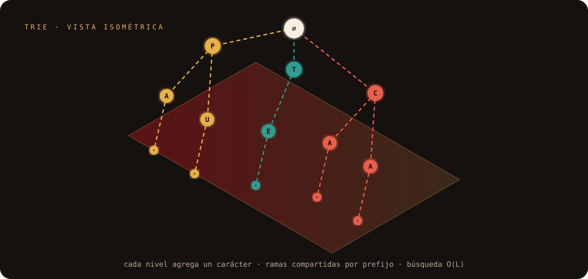
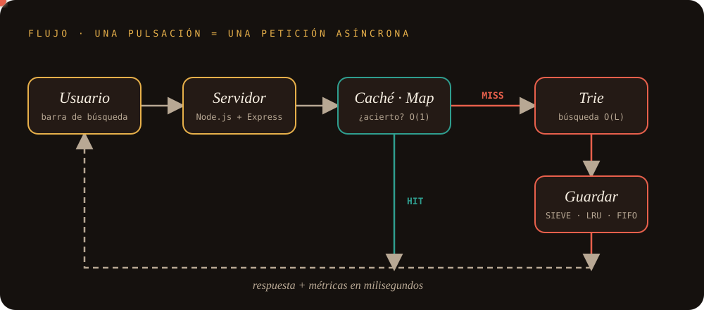
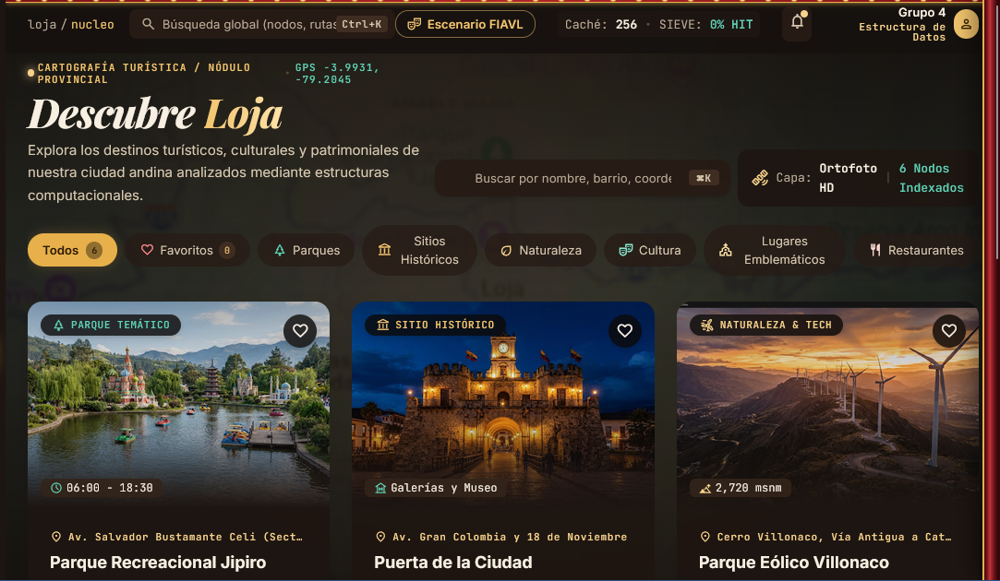
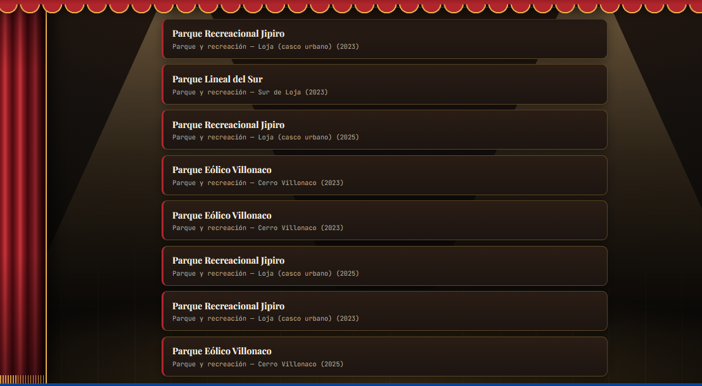
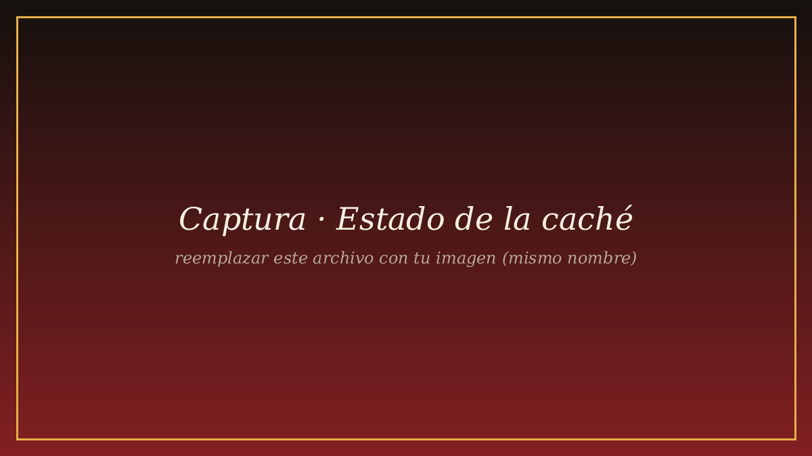
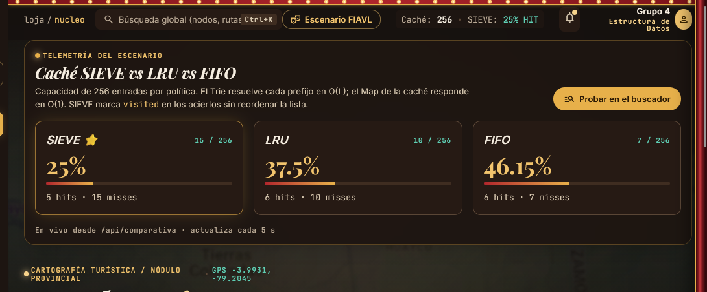

> **Documentación técnica del proyecto**
> Sistema de autocompletado con caché SIEVE para el Festival Internacional de Artes Vivas de Loja (FIAVL)
> Carrera de Computación · Universidad Nacional de Loja · 12 de noviembre de 2026

## Índice

| Sección | Descripción | Acceso |
|:---|:---|:---:|
| 📜 **Resumen** | Visión general del sistema y conceptos clave. | <a href="#resumen"></a> |
| 🎭 **1 · Introducción** | Contexto del FIAVL y objetivos del sistema. | <a href="#1-introducción-y-contexto-del-proyecto"></a> |
| 🌳 **2 · Arquitectura** | Trie, Map y lista doblemente enlazada, con modelo 3D. | <a href="#2-arquitectura-y-estructuras-de-datos"></a> |
| ♻️ **3 · Políticas de caché** | SIEVE vs. FIFO y LRU, animación e indicadores de evaluación. | <a href="#3-políticas-de-reemplazo-de-caché-sieve-vs-fifo-y-lru"></a> |
| 📁 **4 · Directorios** | Estructura del proyecto en Node.js y Frontend. | <a href="#4-estructura-del-proyecto-y-directorios"></a> |
| 🔁 **5 · Flujo de ejecución** | Recorrido de una consulta, interfaz y complejidades. | <a href="#5-controlador-central-y-flujo-de-ejecución"></a> |
| 🏁 **6 · Conclusiones** | Aportes y cierre del proyecto. | <a href="#6-conclusiones"></a> |
| 🖼️ **Anexos** | Evidencias, fotos de Loja, ejecución, estado y equipo. | <a href="#anexos"></a> |

<br/>


## Resumen

Este documento describe el diseño, la arquitectura y la implementación algorítmica de un sistema de autocompletado de alto rendimiento, enfocado en el catálogo turístico y cultural del **Festival Internacional de Artes Vivas de Loja (FIAVL)**.

El núcleo del sistema integra tres piezas:

| Pieza | Papel en el sistema |
|---|---|
| 🌳 **Árbol de prefijos (Trie)** | Búsqueda óptima por prefijo en tiempo `O(L)`. |
| 🗝️ **Índice dinámico (Map)** | Acceso directo a la caché en `O(1)`. |
| ♻️ **Caché SIEVE** | Reemplazo eficiente, contrastado con las políticas clásicas **FIFO** y **LRU**. |

### ✨ ¿Qué es el autocompletado?

Es una función que **sugiere resultados mientras el usuario escribe**, a partir de las primeras letras (el *prefijo*). Por ejemplo, al escribir `pa` el sistema propone lugares del catálogo cuyo nombre empieza así, sin esperar a que se complete la palabra.

### 🧠 ¿Qué es una caché y qué es una política de reemplazo?

La **caché** guarda resultados recientes para no repetir trabajo, pero su espacio es limitado. Cuando se llena, una **política de reemplazo** decide qué elemento sale.

| Caché | Política de reemplazo |
|---|---|
| Es la memoria temporal donde se guardan los resultados ya calculados. | Es la regla que decide qué elemento se expulsa cuando la caché está llena. |
| Ejemplo: las sugerencias obtenidas para el prefijo `pa`. | Ejemplo: **SIEVE**, **LRU** o **FIFO**. |

<p align="right"><a href="#índice"></a></p>


## 1. Introducción y contexto del proyecto

El FIAVL genera una alta concurrencia de consultas digitales sobre **obras, sedes, artistas y eventos culturales**. Para ofrecer una experiencia fluida en tiempo real a residentes y turistas, se propone un backend en **Node.js y Express** que combina estructuras de datos no lineales con estrategias eficientes de gestión de memoria caché.

El sistema prioriza respuestas en milisegundos y evita accesos redundantes a la base de datos o recorridos complejos sobre estructuras pesadas cuando las consultas se repiten.

### 🎯 Objetivos del sistema

- 🎭 Facilitar el descubrimiento de lugares y eventos turísticos y culturales.
- 🌳 Implementar búsqueda por prefijos mediante un árbol Trie.
- ⚡ Optimizar la recuperación de consultas repetidas mediante caché.
- 🔗 Aplicar listas doblemente enlazadas en la administración de memoria.
- ⚖️ Comparar diferentes políticas de reemplazo.
- 📈 Analizar el comportamiento y el rendimiento de las estructuras implementadas.

<p align="right"><a href="#índice"></a></p>


## 2. Arquitectura y estructuras de datos

El sistema descansa sobre tres componentes estructurales ubicados en el servidor.

| Componente | Función | Costo |
|---|---|:--:|
| 🌳 **Árbol de prefijos (Trie)** | Estructura no lineal que almacena el catálogo maestro de lugares turísticos y culturales de Loja. Agrupa los nombres por caracteres compartidos en ramas jerárquicas. | `O(L)` |
| 🗝️ **Tabla hash (Map)** | Índice dinámico y acelerador de la caché. Asocia cada clave de consulta con la referencia exacta de su nodo en la lista de caché. | `O(1)` |
| 🔗 **Lista doblemente enlazada** | Infraestructura física de los nodos en memoria dinámica, con punteros bidireccionales (`prev`, `next`) y un bit de estado. | `O(1)` con referencia |

<sub>`L` es la longitud del texto ingresado.</sub>

<div align="center">



<sub>Figura 1. El Trie en vista isométrica (ejemplo ilustrativo con prefijos de lugares de Loja).</sub>

**🧊 Modelo 3D:** [`assets/modelo3d/trie.stl`](assets/modelo3d/trie.stl) — GitHub lo abre en un visor 3D: arrastra para rotar y usa la rueda para acercar.

</div>

<p align="right"><a href="#índice"></a></p>


## 3. Políticas de reemplazo de caché: SIEVE vs. FIFO y LRU

Para gestionar la capacidad limitada de la caché y optimizar la tasa de aciertos (*hits*), el sistema implementa tres políticas bajo una **interfaz común**: `get`, `put` y `size`.

| Política | Qué hace | Costo operativo |
|---|---|---|
| **FIFO**<br/>*First-In, First-Out* | Inserta siempre al inicio y expulsa al elemento más antiguo, sin modificar su estado ante consultas repetidas. | Bajo, pero ignora el uso. |
| **LRU**<br/>*Least Recently Used* | Reorganiza físicamente los nodos hacia la cabeza en cada acierto y elimina el que más tiempo lleva sin consultarse. | Sobrecarga de reordenamiento **elevada**. |
| **SIEVE**<br/>⭐ *Algoritmo estrella* | Usa un bit booleano (`visited`) y un puntero circular de barrido (`hand`). Descarta elementos impopulares sin reordenar nada en los aciertos (*lazy promotion*). | Reduce drásticamente la sobrecarga en Node.js. |

### 3.1. Lógica operativa de SIEVE

- **Inserción.** Todo elemento nuevo entra por la cabeza (*head*) con `visited = false` (0).
- **Acierto (hit).** El bit `visited` pasa a `true` (1) **sin cambiar la posición** del nodo (*lazy promotion*).
- **Evicción (depuración).** El puntero `hand` recorre la lista. Si encuentra `visited == true`, lo cambia a `false` y avanza; si encuentra `visited == false`, expulsa ese nodo.



<sub>Figura 2. Animación de un ciclo de evicción. La lista se muestra de la cabeza (nuevos) a la cola (antiguos); `hand` avanza de la cola hacia la cabeza, como en la descripción original de SIEVE.</sub>

<details>
<summary><b>Ver un esbozo del algoritmo en JavaScript</b></summary>

Esbozo ilustrativo: los nombres exactos de métodos están en `src/models/CacheSieve.js`.

```js
class CacheSieve {
  constructor(capacidad) {
    this.capacidad = capacidad;
    this.lista = new ListaDoble();   // head = nuevos, tail = antiguos; prev apunta hacia head
    this.map = new Map();            // clave -> nodo, acceso O(1)
    this.hand = null;
  }

  get(clave) {
    const nodo = this.map.get(clave);
    if (!nodo) return undefined;     // miss
    nodo.visited = true;             // lazy promotion: el nodo NO se mueve
    return nodo.valor;
  }

  put(clave, valor) {
    if (this.map.has(clave)) { this.map.get(clave).valor = valor; return; }
    if (this.size() >= this.capacidad) this.#expulsar();
    const nodo = new NodoDoble(clave, valor);   // visited = false
    this.lista.insertarEnCabeza(nodo);
    this.map.set(clave, nodo);
  }

  #expulsar() {
    let nodo = this.hand ?? this.lista.tail;
    while (nodo.visited) {
      nodo.visited = false;                     // segunda oportunidad
      nodo = nodo.prev ?? this.lista.tail;      // al llegar a head, vuelve a la cola
    }
    this.hand = nodo.prev;
    this.map.delete(nodo.clave);
    this.lista.eliminar(nodo);
  }

  size() { return this.map.size; }
}
```

</details>

### 3.2. Indicadores de evaluación

Para comparar las tres políticas bajo una misma secuencia de consultas se miden los siguientes indicadores:

| Indicador | Descripción |
|---|---|
| ⏱️ **Tiempo de ejecución** | Tiempo requerido para procesar la consulta. |
| 🟢 **Aciertos de caché** | Resultados recuperados sin repetir la búsqueda. |
| 🔴 **Fallos de caché** | Consultas que requieren procesamiento. |
| 📦 **Capacidad** | Límite de almacenamiento configurado. |
| ♻️ **Expulsiones** | Elementos eliminados de la caché. |
| 📈 **Rendimiento** | Comparación del comportamiento entre políticas. |

<p align="right"><a href="#índice"></a></p>


## 4. Estructura del proyecto y directorios

El proyecto está modularizado en componentes de Node.js y Frontend:

```text
autocompletado-artes-vivas-sieve/
├── package.json              # Dependencias (Express, etc.)
├── README.md                 # Documentación del proyecto enfocada en FIAVL
├── data/
│   └── artes_vivas_loja.json # Dataset enfocado en obras, sedes, artistas y eventos del festival
├── src/
│   ├── server.js             # Servidor principal Backend (Node.js + Express)
│   ├── models/
│   │   ├── NodoDoble.js      # Nodo con el bit `visited` para la caché SIEVE
│   │   ├── ListaDoble.js     # Lista doblemente enlazada base para la caché
│   │   ├── NodoTrie.js       # Nodos del árbol de prefijos para los nombres del festival
│   │   ├── Trie.js           # Árbol de prefijos O(L) para buscar obras/sedes al instante
│   │   └── CacheSieve.js     # Política de caché estrella: SIEVE (puntero hand + visited)
│   └── public/
│       ├── index.html        # Pantalla de búsqueda del festival de Artes Vivas
│       ├── style.css         # Estilos limpios y modernos (temática cultural/teatral)
│       └── app.js            # Lógica para hacer fetch al servidor al escribir en el buscador
└── tests/
    └── cache_sieve.test.js   # Pruebas unitarias para validar el Trie y el algoritmo SIEVE
```

<sub>Figura 3. Estructura de directorios y componentes del proyecto.</sub>

<p align="right"><a href="#índice"></a></p>


## 5. Controlador central y flujo de ejecución

El controlador central orquesta la interacción entre el usuario y las estructuras internas.



<sub>Figura 4. Flujo de una consulta. La bolita verde recorre el camino de un acierto; la naranja, el de un fallo.</sub>

1. El usuario escribe en la barra de búsqueda de la interfaz web; **cada pulsación genera una petición asíncrona**.
2. El servidor Node.js/Express intercepta la solicitud y consulta primero la caché mediante la tabla hash en `O(1)`.
3. **Acierto (hit):** devuelve las sugerencias culturales al instante.
4. **Fallo (miss):** delega la búsqueda al Trie en `O(L)`, guarda el resultado en la caché con la política activa (**SIEVE**, **LRU** o **FIFO**) y responde al cliente con métricas de rendimiento en milisegundos.

<details>
<summary><b>🧮 Ejemplo: ¿qué pasa al escribir "pu"?</b></summary>

1. La interfaz envía el prefijo `pu`.
2. El servidor consulta el `Map` de la caché: si hay *acierto*, responde sin tocar el Trie.
3. Si hay *fallo*, el Trie recorre `p → u` (2 pasos) y reúne las palabras bajo ese nodo.
4. El resultado se guarda en caché; si está llena, la política activa (FIFO, LRU o SIEVE) expulsa un elemento.

</details>

### 5.1. Interfaz de exploración

La interfaz permite ingresar nombres o fragmentos de palabras para localizar información cultural y turística de Loja. A medida que se introduce texto, el sistema procesa la consulta y presenta las coincidencias disponibles.

| Funcionalidad | Descripción |
|---|---|
| 🔎 **Autocompletado** | Generación dinámica de sugerencias. |
| 🔤 **Búsqueda por prefijo** | Localización a partir de caracteres iniciales. |
| ⚡ **Respuesta dinámica** | Actualización de resultados durante la escritura. |
| 🗂️ **Consulta de catálogo** | Exploración de lugares, obras y eventos. |
| 🩺 **Estado del sistema** | Información sobre el estado de procesamiento. |

### 5.2. Análisis de operaciones

| Operación | Estructura | Complejidad esperada |
|---|---|:--:|
| Recorrido de prefijo | Trie | `O(L)` |
| Acceso a clave | Map | `O(1)` prom. |
| Búsqueda en caché | Map | `O(1)` prom. |
| Inserción local | Lista doble | `O(1)` con referencia |
| Eliminación local | Lista doble | `O(1)` con referencia |
| Recuperación de coincidencias | Trie | Depende del nº de resultados |

<sub>`L` = longitud del prefijo ingresado. La recuperación completa también depende del número de coincidencias.</sub>

<p align="right"><a href="#índice"></a></p>


## 6. Conclusiones

La implementación conjunta del **Árbol de prefijos** para la búsqueda de texto y del algoritmo de reemplazo **SIEVE** ofrece una solución robusta y altamente escalable para portales culturales masivos como el FIAVL.

La evicción basada en el bit de visita y el puntero `hand` minimiza la latencia en el entorno de ejecución de Node.js y evita los cuellos de botella de reordenamiento típicos de políticas tradicionales como LRU.

<p align="right"><a href="#índice"></a></p>


## Anexos

### A. Evidencias del sistema

> **Capturas:** las imágenes de esta tabla son marcadores. Reemplaza cada archivo de `assets/capturas/` con tu captura real, usando el mismo nombre.

| Buscador | Resultados |
|:--:|:--:|
|  |  |
| <sub>Figura 5. Búsqueda por prefijo</sub> | <sub>Figura 6. Sugerencias del catálogo</sub> |
|  |  |
| <sub>Figura 7. Estado de la caché</sub> | <sub>Figura 8. FIFO vs. LRU vs. SIEVE</sub> |

### B. Loja

| | | |
|:--:|:--:|:--:|
|  |  |  |
| <sub>Puerta de la Ciudad</sub> | <sub>Catedral</sub> | <sub>Parque Central</sub> |
|  |  |  |
| <sub>Calle Lourdes</sub> | <sub>Plaza de la Independencia</sub> | <sub>Parque Jipiro</sub> |

<sub>Fotografías: indicar autor y fuente de cada imagen.</sub>

### C. Ejecución local

```bash
git clone URL_DEL_REPOSITORIO
cd autocompletado-artes-vivas-sieve
npm install
npm start      # ajusta al script definido en tu package.json
```

### D. Estado de los componentes

| Componente | Estado |
|---|:---:|
| Árbol Trie | 🟢 |
| Autocompletado turístico | 🟢 |
| Servidor local | 🟢 |
| Gestión mediante Map | 🟢 |
| Lista doblemente enlazada | 🟢 |
| Política FIFO | 🟢 |
| Política LRU | 🟢 |
| Política SIEVE | 🟢 |
| Métricas de consulta | 🟢 |
| Mejoras y pruebas experimentales | 🟡 |

<sub>🟢 Implementado · 🟡 En revisión o mejora · ⚪ Pendiente</sub>

### E. Equipo y datos académicos

| | |
|---|---|
| **Universidad** | Universidad Nacional de Loja |
| **Carrera / ciclo** | Computación · Tercer ciclo |
| **Asignatura** | Estructura de Datos · Grupo 4 |
| **Docente** | Ing. Cristian Narvaez |
| **Período** | Septiembre 2026 – Febrero 2027 |
| **Integrantes** | Yimmy Onner Angulo Torres · Richard Santiago Guaman Sanchez · Freddy Alexander Ordoñez Gonzalez · Joaquin Emilio Moscol Castillo · Erick Jahirs Rogel Baque |

<p align="right"><a href="#índice"></a></p>

